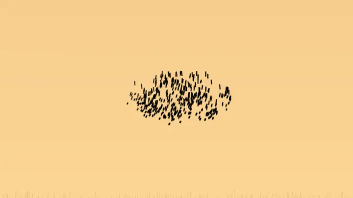

# murmuration-gpu

Starlings at dusk, on your GPU: a research-based murmuration of up to millions
of birds, simulated and rendered in real time. Written in Rust with wgpu.

murmuration-gpu is the big-sky sibling of
[murmuration](https://github.com/ImanolGo/murmuration). The terminal version
draws a few thousand starlings in braille. This version keeps the same flocking
model and moves it to GPU compute shaders. Each bird is a small flapping,
banking body, and the flock is drawn as a dark, grainy silhouette against an
evening sky, the way a real murmuration looks from the ground.

The shapes come from individual birds following local rules. There is no
prerecorded animation, no choreographed outline and no leader.



*One evening, recorded from the app: the flock arrives from its approach
corridor over a gold sky, displays, pours down into the reed bed as the light
goes, and the stars come out. `scripts/evening.sh` reproduces the recording.*

> **Status:** early development. See [PLAN.md](PLAN.md) for the roadmap and
> [Limitations](#limitations) for what this is and is not.

## Goals

- **The real model, not generic boids.** Topological attention (about seven
  neighbours through an adaptive radius), boundary-weighted cohesion, banked
  flight, cruise-speed control, roost attraction and predator responses,
  following StarDisplay (Hildenbrandt, Carere & Hemelrijk, 2010) and the
  starling field studies.
- **Scale.** From tens of thousands of birds up to millions, with the
  neighbour search on the GPU through a sorted uniform grid.
- **Birds, not particles.** Instanced low-poly birds with wingbeats and
  banking near the camera, flapping impostors further out, and sub-pixel
  coverage in the distance.
- **The look of the photographs.** Overlapping birds darken multiplicatively,
  wing exposure drives the travelling dark waves, and a physically inspired
  dusk sky sits behind them.
- **Checked against the reference.** The CPU model from `murmuration` is
  kept as an oracle, and the GPU simulation is compared against it
  statistically.

## Requirements

- Rust **1.95** or newer.
- A GPU with Vulkan, Metal or DX12 support. Development targets Linux and
  Vulkan on a modest laptop GPU (GTX 1650 Mobile, 4 GB).

On hybrid-graphics laptops (NVIDIA Optimus), run on the discrete GPU:

```
prime-run cargo run -p murmuration-gpu --release
```

Unlike a CUDA and OpenGL setup, simulation and rendering share one wgpu
device, so there is no interop step to pair across GPUs.

## Getting started

```
cargo run -p murmuration-gpu --release                          # a dusk flock with the default bird count
cargo run -p murmuration-gpu --release -- --birds 1000000       # one million birds
cargo run -p murmuration-gpu --release -- --falcon              # add an autonomous falcon
cargo run -p murmuration-gpu --release -- --seed 42             # a repeatable start
cargo run -p murmuration-gpu --release -- --arc-minutes 1 --birds 3000   # a one-minute evening
cargo run -p murmuration-gpu --release -- --no-arc              # hold the display phase
```

The evening arc is on by default at 15 minutes: the flock arrives from its
approach corridor, displays over the roost, pours down into the reeds as the
light goes, and is cleared by night.

Headless tools, without opening a window:

```
cargo run -p murmuration-gpu --release -- --bench --birds 1000000          # GPU timings per pass
cargo run -p murmuration-gpu --release -- --parity --birds 2000 --seed 42  # GPU vs CPU reference statistics
cargo run -p murmuration-gpu --release -- --analyze 120 --birds 50000      # per-second flock statistics
cargo run -p murmuration-gpu --release -- --coherence 600 --birds 100000   # long-run coherence run + verdict
cargo run -p murmuration-gpu --release -- --still docs/still.png --birds 1000000  # one rendered frame
cargo run -p murmuration-gpu --release -- --record DIR --birds 8000 --arc-minutes 3  # one evening as a time-lapse
cargo run -p murmuration-gpu --release -- --agitation --birds 2000 --seed 42  # the zigzag-wave experiment
cargo run -p murmuration-gpu --release -- --lod-sweep                         # the LOD transition measurement
```

`--record DIR` renders one evening as a time-lapse, one frame per step, for
`--frames` frames; [scripts/evening.sh](scripts/evening.sh) runs it and encodes
the animated WebP and the still that this README shows. `--agitation` runs the
agitation-wave experiment on the GPU and on the CPU oracle and prints both, and
`--lod-sweep` sweeps one bird across every level-of-detail threshold and prints
the transition measurement.

`--analyze SECONDS` prints the same per-second line and summary as the CPU
oracle (`cargo run -p murmur-ref --bin analyze --release -- …`); add
`--extended` for the extra statistics line.

`--coherence SECONDS` runs the long flock and checks it against the phase 4
criteria in [docs/coherence-100k.md](docs/coherence-100k.md), printing a verdict
table and `# coherence PASS|FAIL`. It uses a lighter sampler that measures only
the fields the criteria read — bit-identical to the ones `--analyze` prints, but
without the 15 m nearest-neighbour scan that makes the full metric set cost ~26 s
per simulated second at 100,000 birds.

`--still PATH` simulates `--seconds` (default 60) of the flock, frames it with
the ground camera and writes one 1280×720 PNG, and prints the wall clock it took.
It is a simulation, not a screenshot: a million-bird frame is ~56 minutes on a
GTX 1650 (see [docs/progress.md](docs/progress.md), phase 5).

At one seed the GPU output is *statistically* comparable to the CPU oracle, not
identical: the two engines draw the random force from different generators (see
[Limitations](#limitations)).

## Tests

```
cargo test                     # everything, including the GPU tests
prime-run cargo test           # the same, forced onto the discrete GPU
cargo test -p murmur-ref       # the CPU oracle alone, no GPU needed
```

Some tests open a device and run real simulations: the `--analyze` and
`--coherence` checks, the grid, the falcon, the agitation wave and the evening
arc. They print `SKIP:` and pass when no adapter is found, but when one is
present they want it to themselves — a window or a `--record` run in another
terminal will make them many times slower, and on a hybrid-graphics laptop
`prime-run` picks the discrete GPU instead of the integrated one.

Planned controls:

| Input          | Action                                  |
| -------------- | --------------------------------------- |
| `q` / `Esc`    | Quit                                    |
| `Space`        | Pause or resume                         |
| Mouse drag     | Orbit the observer around the roost     |
| `f`            | Spawn an autonomous falcon              |
| Move the mouse | Steer the falcon                        |
| `+` / `-`      | Change the flock size                   |
| `h`            | Show or hide the overlay and timings    |

## How it works

Each frame runs a fixed-step simulation, then a render pass, on one GPU:

```
┌──────────────────────────────── GPU ────────────────────────────────┐
│                                                                     │
│  simulate (fixed step, compute)                                     │
│    1. hash birds into a uniform grid (fixed-size table)             │
│    2. counting sort by bucket, into an index array for locality     │
│    3. per bird: scan the cells its adaptive radius covers, keep     │
│       every bird inside it, accumulate the social forces            │
│    4. banked flight, speed control, altitude, roost, predator       │
│    5. integrate into the next state buffer                          │
│                                                                     │
│  render                                                             │
│    6. dusk sky                                                      │
│    7. birds by projected size: meshes, impostors, coverage points   │
│    8. multiplicative darkness accumulation, no sorting needed       │
│    9. temporal anti-aliasing, tone map                              │
│                                                                     │
└─────────────────────────────────────────────────────────────────────┘
```

The bird state buffer that the simulation writes is the same buffer the
render pass reads. Nothing is copied back to the CPU during normal running.

### Workspace

```
crates/
  murmur-ref/      CPU reference model and flock statistics (the oracle)
  murmur-gpu/      wgpu compute: grid, sort, neighbours, forces, integration
  murmur-render/   sky, bird LOD, darkness accumulation, TAA, tone mapping
app/               the murmuration-gpu binary: window, camera, input, CLI
```

## Limitations

This is a research-inspired visual simulation, not a validated predictor of
wild flocks. The same caveats as the terminal version apply, plus:

- The neighbour search is a radius query, as the model is: each bird keeps
  every bird inside its own adaptive radius rather than an exact global
  k-nearest set. The radius targets about seven neighbours but is not capped
  at seven.
- GPU results are not bit-identical to the CPU reference. A seed gives a
  repeatable start, and parity is checked with flock statistics rather than
  frame by frame.
- Millions of birds is beyond the size of most real murmurations. Large
  counts are an artistic choice.
- Performance figures are only reported when measured with GPU timestamps on
  named hardware.

## References

See the [references in murmuration](https://github.com/ImanolGo/murmuration#references).
The main ones for this project:

- Hildenbrandt, Carere & Hemelrijk (2010). Self-organized aerial displays of
  thousands of starlings: a model. *Behavioral Ecology* 21(6).
- Ballerini et al. (2008). Interaction ruling animal collective behavior
  depends on topological rather than metric distance. *PNAS* 105(4).
- Hemelrijk, van Zuidam & Hildenbrandt (2015). What underlies waves of
  agitation in starling flocks. *Behav. Ecol. Sociobiol.* 69(5).
- Costanzo, Hildenbrandt & Hemelrijk (2022). Causes of variation of darkness
  in flocks of starlings, a computational model. *Swarm Intelligence* 16.
- Green, S. (2010). Particle simulation using CUDA (uniform grid with
  sorting). NVIDIA whitepaper.

## License

MIT
